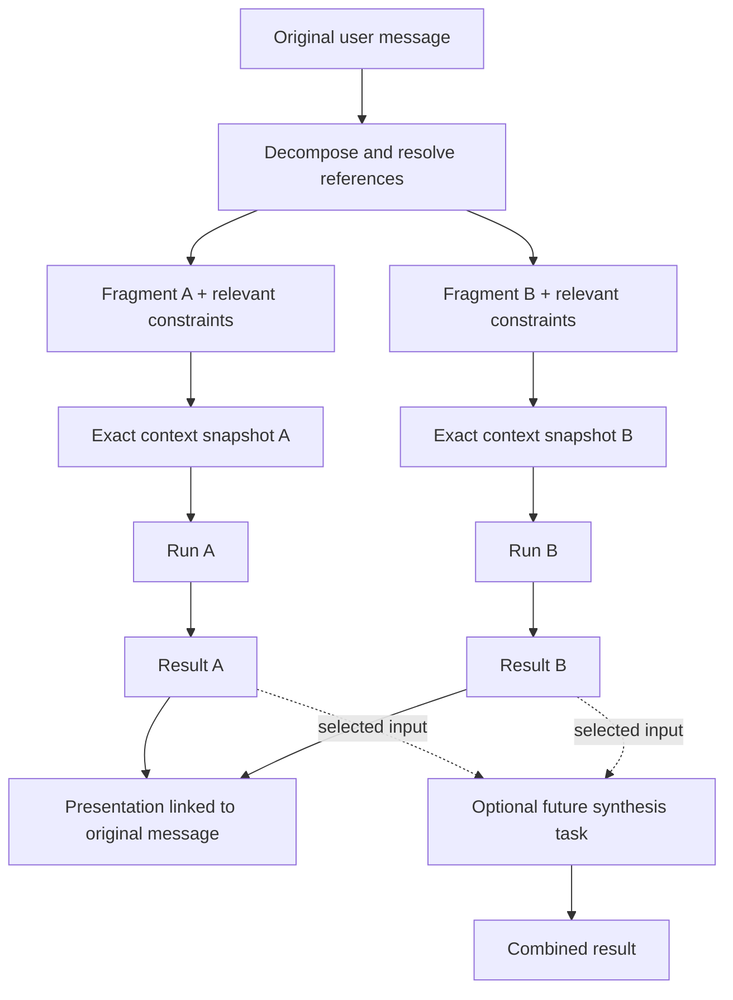
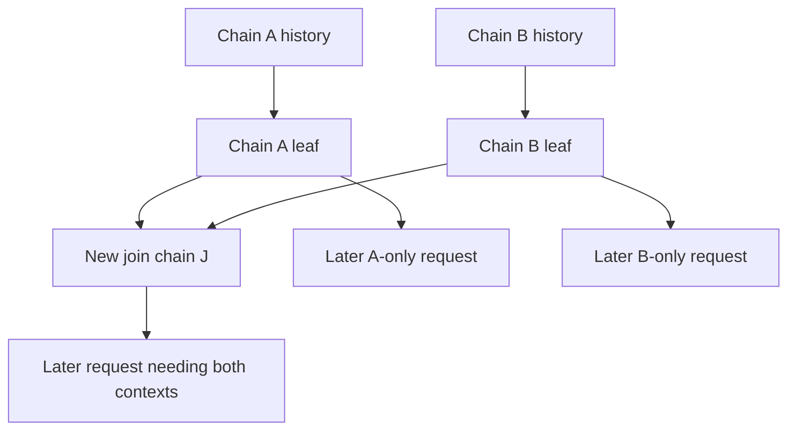
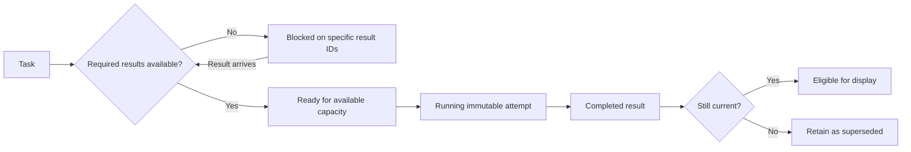

> **Archived.** Copy of the original design discussion record (`concurrent-chat-design.md`), made 2026-11-10 so the sources cited by the spec's debug views are in the repository. History only; the current specification is [`docs/spec/`](../../spec/README.md). See the [archive README](../README.md).

# Concurrent chat — design discussion

Status: discussion record, not an approved implementation specification.

## Confirmed

- One visible chat, multiple concurrent model runs underneath.
- Initial scope: text and read-only work.
- A dependency means needing an unavailable result; topic overlap alone is insufficient.
- Preserve original user messages. Underlying chains receive relevant fragments.
- No LangChain or LangGraph in this project.
- Decomposition identifies shared requirements, but errs toward one atomic task for tightly linked topics, contrast, or a unified output. Caching and indexes are an example to keep together.
- Join only when necessary. A join creates a new chain with parent edges to specific leaf nodes of both source chains and a new visual color. Both source chains remain available for future routing.
- A future request may target source chain A, source chain B, or join chain J depending on its context needs.
- Revision is a distinct routing outcome: supersede affected attempts, cancel where possible, regenerate with updated constraints, and check affected descendants.
- Display order follows request order; processing is topological and dependency-driven.
- A changing status/loading badge lives on the user message. Later requests can show replies while earlier requests remain in flight; an upward affordance can point to pending earlier work.
- Debug toggles: color-coded chain mini-map with IDs on hover; chain colors in chat; composite-message rewritten fragments; live operation topology including reply generation, tools, subagents, and fork join-back.
- Fork join-back records both completed exchanges for future context, serialized in request order (first user message + first reply, then second user message + second reply). This does not claim the second parallel run saw the first reply.
- Debug mini-map uses an unfilled dotted oval around nodes representing messages processed in parallel.
- Composite requests display independently streaming answer sections under the original request.
- Each assistant message has a lightweight reply-to badge. Untargeted user follow-ups use UX elicitation when genuinely ambiguous.
- Multi-chain message/reply styling remains a visual design choice.

## Technical basis

Autoregressive token generation is sequential within a run. Serving systems can execute independent runs concurrently using the same model weights. The product problem is selecting context, scheduling work, and presenting concurrent results coherently; separate physical model copies are unnecessary.

Context ancestry, result dependencies, and display order are distinct relationships. A forest can represent ancestry with one parent per branch. Multiple result inputs create a DAG at the execution layer without requiring permanent merger of conversation chains.

## Proposed architecture — decisions still open

The dotted inputs exist only when a later task needs both results. Completion of A and B alone does not trigger a synthesis run or alter their histories.

## Routing must separate relation from target

| Incoming intent | Relation | Proposed behavior |
| --- | --- | --- |
| “Also explain dinosaurs” | New independent work | Run against a selected context snapshot |
| “Explain this same topic for engineers” | Related new work | Reuse relevant existing context; no wait unless a specific result is needed |
| “Expand the recommendation you are preparing” | Needs an unfinished result | Block on that result |
| “Actually, both explanations are for engineers” | Revision affecting multiple tasks | Update scoped constraints; supersede affected attempts, regenerate, and check affected descendants |
| “Compare the two answers” | Needs two results | Create a task with two result inputs; retain both source chains |
| “Use that one” with several possible referents | Unresolved target | Resolve or ask; do not assume a target merely from topic similarity |

Dependency classification must reflect the intended evidence: a fresh independent answer and a comparison grounded in two pending results are different tasks even if their wording is similar.

## Decomposition boundary

“Explain caching and indexes for beginners” should err toward one atomic task: related concepts and likely comparison benefit from one answer. Multiple nouns are not evidence of independent intent.

A clearer candidate composite: “Explain why the sky is blue, and separately translate this restaurant menu into French. Keep both accessible to a beginner.” Each fragment receives its applicable shared requirements and provenance. Exact source and rewritten text are both retained.

An aggregate constraint such as “Keep both answers under 100 words total” requires allocating a budget or composition. Shared requirements must be identified before scheduling, even without result dependencies.

## Chain joins and operation dependencies

Chain identity is distinct from node identity. A join points to the exact source nodes it read, not mutable chain heads. Later advances in A or B do not retroactively change J's input. Whether a future J continuation imports newer source results requires explicit context selection.

The chain mini-map shows context lineage. The operation graph shows the live work and its prerequisites. Tools and subagent work can appear in the latter without automatically becoming new user-facing chains.

Fork join-back is context bookkeeping: record completed exchanges in request order for future continuation, without automatic model synthesis. The debug map retains the true parallel execution, grouping those nodes in a clear dotted oval. Preserve the exact input snapshot of each historical run separately from the assembled context for a future run. Serializing the future context must not overwrite historical input provenance.

A new join chain is a different operation: it reasons across source results and has its own chain identity/color. Provider-specific storage and serialization API choices remain unselected.

## Execution and presentation

This is not a complete state machine: error, cancellation, retry, and failure propagation policies remain unspecified. A blocked dependency should not hold unrelated ready work behind it in a FIFO execution queue. Display is positioned by request order but is not a global completion barrier: later reply areas may populate while earlier user-message badges still show work in progress. The up-arrow affords navigation to earlier pending work.

## Confirmed debug surfaces and proposed details

- Chain mini-map: stable per-chain color; exact IDs on hover, with focus/tap access as well.
- Chat coloring toggle: use the same chain colors as the mini-map. Multi-chain content needs an explicit design; proposed segmented marks/chips rather than a blended color that resembles a new chain.
- Composite inspector: show the untouched source message beside rewritten atomic instructions and inherited requirements.
- Operation inspector: dependency topology with operation type and live status, including generating replies, waiting for tools/subagents, and join-back if scheduled. Distinguish waiting on prerequisites from ready but waiting on capacity.
- Pending-work navigation: changing status badge on each user message and an up-arrow to earlier pending work.

## Run inspector proposal

Selecting a run should reveal:

1. Original user message and source fragment.
2. Resolved task instructions and applicable constraints, with provenance.
3. Exact model input for that attempt, including selected history and result inputs.
4. IDs of unfinished results it is waiting for, separate from context ancestry.
5. Routing decision and explanation; classifier confidence if available, without implying correctness.
6. Attempt version and whether its result is current, superseded, failed, or cancelled.
7. The visible message/answer slot to which the result belongs.

The original source text and any model-generated rewrite should both be recorded, so a lost constraint can be traced to decomposition rather than blamed on the answering model.

Revision tracking also applies to descendants: if B consumed A's old result, replacing A does not repair B. Mark affected descendants as potentially stale and choose recomputation or review explicitly. Preserve source lineage when sharing evidence so the same finding copied across branches is not mistaken for independent corroboration.

## Jev's possible role

TypeSafe's Jev takes supplied state and predefined typed questions. It can classify whether decomposition is needed, choose among candidate targets, or judge candidate dependency edges. Its documented interface does not generate arbitrary novel task descriptions. A generative planner or deterministic extractor is needed for that stage. Questions in one Jev call independently see the same input state; later decisions cannot consume earlier answers in the same call. Dependency accuracy must be evaluated on this application's cases.

Candidate pipeline, not a settled choice: original message → decomposition when needed → candidate context/target selection → bounded relation classification → validated task graph → scheduling. Avoid adding a mandatory classification request to every trivial message until latency is measured.

## Open decision frontier

- Visual selection: chat presentation, mini-map layout, multi-chain markers, split inspector, ambiguity elicitation, and live operations inspector.
- Further behavior questions are deferred while the user compares UX prototypes.

Later decisions include future context selection after join/source updates, partial-stream supersession, cancellation UX, error propagation, context compaction, routing evaluation, and resource budgets. They remain open rather than silently defaulted.

## Research sources

- [Transformer paper, autoregressive generation](https://arxiv.org/html/1706.03762v7)
- [vLLM documentation, serving and continuous batching](https://docs.vllm.ai/en/stable/)
- [OpenAI conversation state](https://developers.openai.com/api/docs/guides/conversation-state)
- [OpenAI parallel conversations and ancestry](https://developers.openai.com/api/docs/guides/websocket-mode#run-conversations-in-parallel)
- [TypeSafe introduction and decision primitives](https://docs.typesafe.ai/introduction)
- [TypeSafe state and relevant context](https://docs.typesafe.ai/concepts/state)
- [TypeSafe speculative fan-out](https://docs.typesafe.ai/patterns/fan-out)
- [TypeSafe confidence interpretation](https://docs.typesafe.ai/confidence)
- [TypeSafe Choice design](https://docs.typesafe.ai/primitives/choice)
- [Anthropic multi-agent research system: synchronous barriers and asynchronous coordination](https://www.anthropic.com/engineering/multi-agent-research-system)

Architectural proposals above are inferences from these capabilities, not claims that the providers supply this product out of the box.

## UX exploration — November 10, 2026

Three Terra subagents created isolated interactive fixture prototypes, not production implementation:

- `chat-directions.html`: request-ordered conversation, status badges, parallel answer sections, reply targeting, ambiguity elicitation, and split/color debug affordances.
- `chain-map-directions.html`: alternate mini-map layouts, exact-node ancestry, colored join chains, dotted parallel group, and context inspection.
- `operation-directions.html`: alternate operational topology/status layouts and simulated dependency-driven progress.

Selected by the user:

- Chat: **Sections**.
- Chain mini-map: **Genealogy**.
- Operations: **Dependency map**, refined into a PERT-style network with an indefinitely extensible horizontal scroll surface.
- Completing operations fade away; surviving operations transform into their new layout positions. Maintain dependency correctness and preserve inspection/history after visual retirement.

The previous alternatives remain exploratory references, not competing approved directions.

Validation: inline JavaScript syntax passed for all three prototypes. Browser visual verification was blocked because the bundled visualization preview renderer could not locate its visualize.css asset. Inline host rendering remains to be assessed by the user.

## Selected operation-view refinement

Use activity-on-node PERT-style topology flowing left to right. Horizontal position expresses dependency depth, not elapsed time; this prototype does not invent duration estimates or critical-path calculations. A growing task graph extends the scroll surface horizontally. The fixture demonstrates extension; production virtualization and unbounded data loading are later implementation work.

Completion motion serves state indication and spatial continuity: fade completed operations, then compact survivors using transform-based movement. Respect reduced motion, maintain selected-node details, and avoid force-scrolling users who are inspecting another part of the graph. Exact prototype timings are documented with the implementation.

## Additional debug UX exploration

The user emphasized decomposition inspection and message-to-chain association as core UX. New Terra explorations retain the selected Sections chat and Genealogy map:

- `decomposition-debug-directions.html`: alternate source-to-fragment inspection treatments, applicable shared requirements, rewritten prompts, and linked answer-section selection.
- `chain-association-directions.html`: alternate chain identity encodings, multi-chain original messages, linked map/chat selection, and explicit separation of handling chain from context ancestry.

A synthesis reply handled by J should be colored as J; reading A and B is separate ancestry metadata. A composite source message routed to A and B should show both memberships without creating an apparent third chain color.

Completed refinement: the PERT-style operation fixture supports horizontal extension, 180 ms completion fade and 240 ms transform reflow. Connector endpoints track node positions during reflow; reduced motion removes position transitions. Recent completion details remain inspectable. Decomposition variants are In context, Compare, and Fragments. Chain association variants are Rails, Chips, and Focus. These new debug choices remain proposals. JavaScript syntax checks passed; browser visual checks remain unverified.

## Approved debug treatments — November 10, 2026

- Decomposition inspector: **Compare** is selected. Preserve **Fragments** as a retained alternative for a later trial; it is not the default.
- Chain association: combine **Margin rails + Focus**.
- Genealogy hover/focus is inheritance-aware: focusing J includes messages in the exact A/B ancestry consumed by J, plus J's own messages. In the prototype this includes all messages. Ownership colors remain A/B/J; inherited content is not relabeled as handled by J. Future messages on A/B that J never consumed must not become part of J's highlight merely because they share a chain ID.
- Pointer hover and keyboard focus should preview association; click/tap can pin selection. Leaving a transient preview restores the pinned/default state.
- Operation queue visual direction is accepted as presented.

Compare and combined Margin rails + Focus are approved directions. Fragments remains available for revisiting. No production integration has been requested or performed.

## Project-local samples and Q27

The five Terra UI samples were copied unchanged into `/Users/winstondu/Documents/SideProjects/Committee/prototypes/ui/`, with a README identifying selections and runtime requirements. The originals remain for existing inline embeds. Q27 supersedes the earlier overall-failure rule: failure applies only to the affected directive; siblings continue, and the overall request is not failed. Project scenario documents contain the current decisions.
