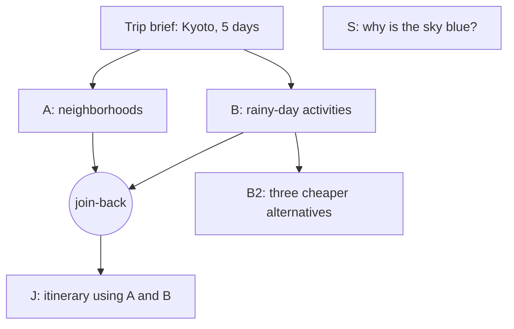

# 01 · Mental model

How to think about a Committee conversation. The later documents are detailed rules; this one is the picture they all assume. Terms in bold are defined in the [glossary](glossary.md).

## One chat, many lines of work

The user sees a single conversation. Underneath, each request is answered by its own model run, and several runs are usually in flight at once. A run does not read the visible transcript. It reads the context of the **chain** it belongs to.

A conversation's chains form a **genealogy**: a set of trees whose nodes are exchanges (a request and its answer). Following a node's parents back to the root gives exactly the context that node's run could read.

- `S` is unrelated to the trip, so it started a **new chain**. It never sees trip context, and trip work never sees it.
- `A` and `B` were sent while the trip chain was busy, so they are **forks**: parallel continuations from the same starting context. Neither saw the other's result. Each fork has its own chain color (Q89).
- When both finished, a **join-back** formed automatically. It is a bookkeeping node, not a model call: it records both exchanges in the order they were sent so later work on the chain can read them.
- `J` needs both A and B, so it continues from the join-back. The join-back resumes the chain A and B forked from, so J is that chain continuing, in its color, not a new one (Q78).
- `B2` is an explicit follow-up to B alone. It branches from B, reads B's ancestry, and does not inherit A (Q30). As a later branch from one sibling it has its own chain color (Q89).

## Three relationships, never merged

Every design decision depends on keeping these apart. None is derived from another.

| Relationship | Question it answers | Shape | Example |
|---|---|---|---|
| **Context ancestry** | What did this run read? | The genealogy above | J read the brief, A, and B |
| **Result dependency** | What must finish before this can start? | A graph over attempts and join-backs | J cannot start until A and B have both finished |
| **Display placement** | Where does it appear in the chat? | A single ordered transcript | J's reply sits wherever its first text appeared |

Typical mistakes this prevents: assuming an answer saw everything shown above it; making a request wait because an earlier one is slow; reordering the transcript when work finishes.

## Where new work goes

A submitted message is placed in exactly one of three ways (Q76):

| Placement | When | Effect on the genealogy |
|---|---|---|
| **New chain** | The work is unrelated to anything existing | A new root |
| **Continue an existing chain** | The work builds on a chain's context | A child of the point it builds on. If that point already has work in flight, the new work is a fork beside it. Work that builds on a closed sibling group as a whole continues from its join-back; a reply to one sibling branches from that sibling |
| **New join chain** | The work needs the context of lines that have diverged | A node whose parents are two or more leaves (Q86, Q88) |

A **join chain** is rare. It is needed only when the lines being combined are not siblings of one group: leaves of different branches of one tree (for example `J` and `B2` above), or leaves of previously separate trees (for example the trip and `S`). Its sources stay independently continuable, and what it inherited does not grow when they continue.

Work that needs several siblings of the same group never uses a join chain. It waits for that group's join-back and continues from it.

## Chain colors

Each chain has one stable color, used wherever chains are shown ([debug views](09-debug-views.md)).

| Line of work | Color |
|---|---|
| A new chain | Its own |
| A fork | Its own (Q89) |
| A join-back and the work continuing from it | The color of the chain the siblings forked from (Q78) |
| A later branch from one sibling | Its own (Q89) |
| A join chain | Its own (Q5) |

## Sibling groups

A **sibling group** is the set of forks that share a starting context.

- It is open while members are in flight. Another request from the same starting context joins it.
- A request that consumes one member's result is that member's descendant, not a member.
- It closes once every member has completed, or has failed, been stopped, or been interrupted and is not retrying. A member that is still retrying keeps it open. The join-back then forms, and a closed group is never enlarged (Q49, Q92).
- If a member that did not complete is retried after the group has closed, the retry is not a member: it runs as a descendant of the join-back (Q92).
- Work needing more than one member must depend on the whole join-back, never on a chosen subset (Q30).

## The unit of work

| Level | What it is |
|---|---|
| **Original message** | What the user typed, always preserved |
| **Directive** | The unit of work that produces one answer section: an atomic message, or one **fragment** of a composite message. It fails, stops, and retries on its own |
| **Attempt** | One execution of a directive. Revisions and retries create new attempts; earlier ones are kept |

A directive is, at any moment, in one of these situations:

| State | Meaning |
|---|---|
| Dependency-queued | Waiting for a result it needs |
| Paused | Waiting for user action: an answer to a clarification question, before it starts or after partial output; or a recovery choice after the result it needs failed, was stopped, or was interrupted. Its pause reason determines how it resumes ([elicitation](07-elicitation.md), [failure and recovery](08-failure-and-recovery.md)) |
| Waiting for capacity | Ready, held back by a provider's rate limit |
| Running | An attempt is in flight (status only, or streaming answer text) |
| Completed | Finished successfully; only this releases dependents |
| Failed | Ended in an error after any automatic retries |
| Stopped | An attempt ended deliberately by the user. An attempt Committee ends in order to replace it is superseded, not stopped |
| Cancelled | Work cancelled by the user before it started: queued work inside a stopped request, or a request paused for dependency recovery that the user chose to cancel (Q91) |
| Interrupted | Lost because whatever was executing it stopped unexpectedly |
| Superseded | Replaced by a revision; kept as history |

## Principles that hold everywhere

1. **History is never rewritten.** Superseded, failed, stopped, and interrupted attempts stay, marked as what they are.
2. **Every attempt records exactly what it read**, and that record never changes when later work finishes, is revised, or is retried.
3. **Only success releases a dependency.** Streaming text never does.
4. **A fresh attempt starts clean.** Replacements and retries never read an earlier attempt's partial text.
5. **Failure is local.** There is no failed or cancelled status for a request as a whole; those states belong to individual directives.
6. **Committee does not guess silently.** When a choice is the user's, it asks; it acts on a default only when the action is reasonable and reversible.
7. **The decision model selects, it does not write.** Routing chooses among candidates Committee supplies.
